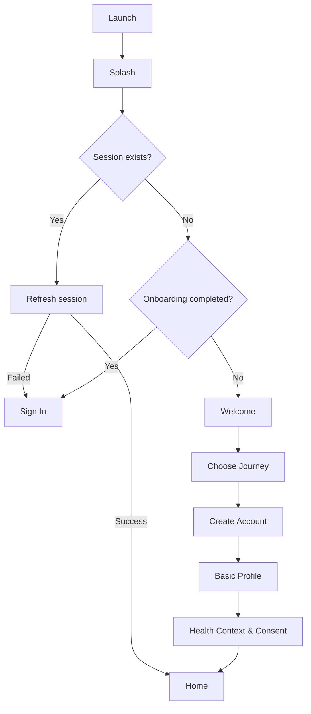
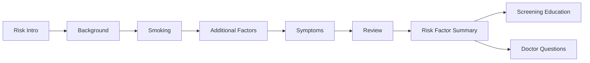
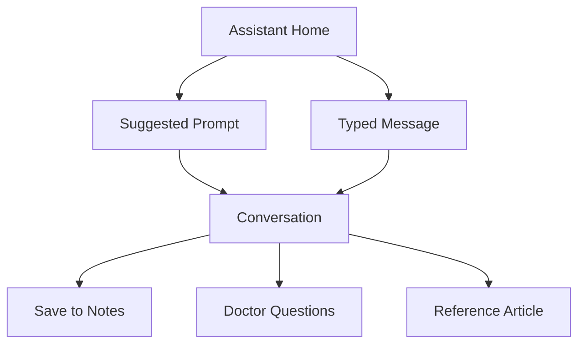
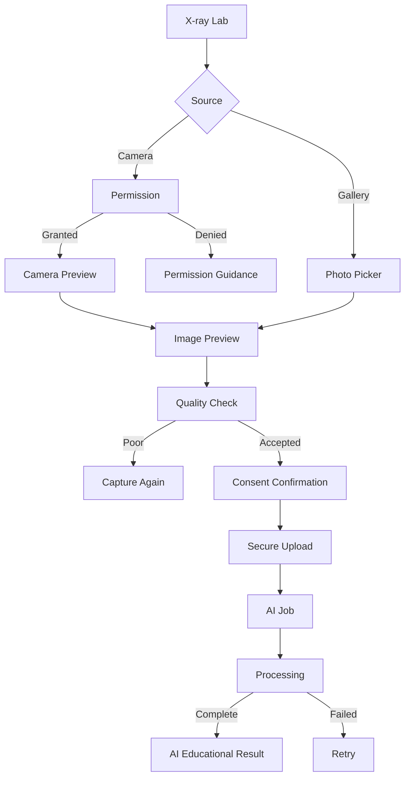

# LungCare AI — Complete Screen & Navigation Flows

هذا الملف هو المرجع التنفيذي للتنقل والسلوك بين جميع شاشات Android والـBackend.

## قواعد عامة

### Navigation

- استخدم Navigation Compose وTyped Routes.
- كل شاشة فرعية يجب أن تدعم زر الرجوع.
- زر الرجوع يعيد المستخدم إلى الشاشة السابقة مع الاحتفاظ بالبيانات غير المرسلة داخل `SavedStateHandle`.
- عند وجود تغييرات غير محفوظة، اعرض نافذة:
  - حفظ كمسودة.
  - تجاهل التغييرات.
  - إلغاء والعودة للنموذج.
- لا يظهر Bottom Navigation في شاشات Onboarding أو النماذج متعددة الخطوات أو عرض المستند أو تصوير الأشعة.
- الضغط على عنصر Bottom Navigation النشط يعيد الشاشة إلى بدايتها.
- الضغط مرة ثانية على Home ينقل المستخدم إلى أعلى الصفحة.

### Authentication guard

```text
App Launch
├── Valid session → Home
├── Expired access token + valid refresh token → Refresh → Home
├── Refresh failed → Sign In
└── First launch → Splash → Welcome
```

### Global UI states

كل شاشة مرتبطة بالـBackend يجب أن تدعم:

```text
Loading
Content
Empty
Offline with cached data
Offline without data
Validation error
Server error
Unauthorized
Retry
```

### Data sources

- بيانات المستخدم النهائية: Backend.
- المسودات والعمل بدون إنترنت: Room.
- اللغة والثيم وحالة Onboarding: DataStore.
- الصور والملفات: Private Object Storage عبر روابط رفع مؤقتة.
- تحليل الـAI: Backend job، وليس اتصالًا مباشرًا من Android.

---

# Flow 1 — App Launch & Onboarding



## 1. Splash

**Route:** `splash`

**Entry:** App launch.

**Actions:**

- No manual action required.
- Check DataStore onboarding status.
- Check encrypted token storage.
- Attempt token refresh when necessary.

**Navigation:**

- Valid session → `home`.
- First launch → `welcome`.
- Existing user without session → `signIn`.

**States:**

- Loading logo animation.
- Network refresh timeout.
- Offline with valid cached session → allow local mode, then synchronize later.

## 2. Welcome

**Route:** `welcome`

**Primary action:** Get Started → `chooseJourney`.

**Secondary action:** I Already Have an Account → `signIn`.

**Other actions:**

- Language toggle updates DataStore and recomposes the entire app.
- Theme toggle updates DataStore.
- Privacy link → `privacyPublic`.

**Back:** Android system back exits the app after confirmation only if accidental exit protection is desired.

## 3. Choose Journey

**Route:** `chooseJourney`

**Options:**

- Early Detection.
- Under Medical Evaluation.
- Living With Lung Cancer.

**Primary action:** Continue → `createAccount`.

**Validation:** One journey must be selected.

**Persistence:** Save temporary selection in `SavedStateHandle`; send it after account creation.

**Back:** `welcome`.

## 4. Create Account

**Route:** `createAccount`

**Fields:**

- Full name.
- Email.
- Password.
- Terms acceptance.

**Primary action:** Create Account.

**Backend:**

```text
POST /api/v1/auth/register
```

**Success:** Securely store tokens → `basicProfile`.

**Secondary:** Sign In → `signIn`.

**Validation:**

- Valid email.
- Password policy.
- Terms accepted.
- Display field-level backend errors.

**Error states:**

- Email already exists.
- Weak password.
- Network error.
- Rate limited.

## 5. Sign In

**Route:** `signIn`

**Primary action:** Sign In.

**Backend:**

```text
POST /api/v1/auth/login
```

**Success routing:**

- Profile complete → `home`.
- Profile incomplete → `basicProfile`.
- Consent version outdated → `healthConsent`.

**Secondary actions:**

- Forgot Password → `forgotPassword`.
- Create Account → `createAccount`.

## 6. Forgot Password

**Route:** `forgotPassword`

**Flow:**

```text
Enter email
→ POST /auth/password-reset/request
→ Confirmation screen
→ Open verified deep link
→ New password
→ Sign In
```

Never reveal whether an account exists for the entered email.

## 7. Basic Profile

**Route:** `basicProfile`

**Fields:**

- Preferred name.
- Date of birth.
- Preferred language.
- Country or region.
- Optional profile image.

**Primary:** Continue.

**Backend:**

```text
PATCH /api/v1/me
PATCH /api/v1/me/preferences
```

**Success:** `healthConsent`.

**Back:** Account screen, while preserving fields.

## 8. Health Context & Consent

**Route:** `healthConsent`

**Optional fields:**

- Smoking-history category.
- Areas of interest.
- Reminder preference.
- Personalization consent.

**Primary:** Complete Setup.

**Secondary:** Skip for Now.

**Backend:**

```text
POST /api/v1/consents
PATCH /api/v1/me/preferences
```

**Success:** `home`.

Consent must include version and timestamp.

---

# Flow 2 — Home & Global Navigation

## 9. Personalized Home

**Route:** `home`

**Entry:**

- Successful authentication.
- Bottom navigation Home.
- Completion of onboarding.

**Content changes by journey:**

- Early detection → Risk assessment CTA.
- Evaluation → Next appointment and pending records.
- Patient care → Care timeline, side effects, and follow-up.

**Actions:**

- Avatar → `profile`.
- Notification icon → `notifications`.
- Language toggle → update DataStore.
- Theme toggle → update DataStore.
- Hero CTA → journey-specific destination.
- Computer Vision card → `xrayCapture`.
- Track Symptom → `symptomOverview`.
- Screening Guide → `screeningEducation`.
- Doctor Questions → `doctorQuestions`.
- Medical Records → `records`.
- Education card → `articleDetails`.
- View All → `educationHub`.

**Backend reads:**

```text
GET /me
GET /appointments?upcoming=true
GET /symptoms?limit=3
GET /notifications?limit=5
GET /medical-records?limit=3
```

**Pull to refresh:** Refresh dashboard data.

**Empty states:** Hide fabricated data and show a clear action.

## 10. Notification Center

**Route:** `notifications`

**Actions:**

- Notification → context destination.
- Mark read.
- Mark all read.
- Notification settings → `notificationSettings`.

**Backend:**

```text
GET   /notifications
PATCH /notifications/{id}
POST  /notifications/read-all
```

**Back:** Home.

---

# Flow 3 — Risk Assessment



## 11. Risk Introduction

**Route:** `risk/intro`

**Primary:** Start Assessment → `risk/background`.

**Secondary:** Learn More → `screeningEducation`.

**Back:** My Health.

**Required notice:** Not a diagnostic test.

## 12. Age & Background

**Route:** `risk/background`

**Fields:**

- Age/date of birth.
- Previous lung screening.
- Relevant lung-health history.

**Primary:** Continue → `risk/smoking`.

**Secondary:** Back → Intro.

**Save & Exit:** Store Room draft → My Health.

## 13. Smoking History

**Route:** `risk/smoking`

**Options:**

- Never smoked.
- Current smoker.
- Former smoker.
- Prefer not to answer.

**Conditional fields:**

- Cigarettes per day.
- Years smoked.
- Quit date or years since quitting.

**Calculation:** Pack-years only when enough data exists.

**Primary:** Continue → `risk/additional`.

**Back:** Background.

**Validation:** Numeric values must be within reasonable non-negative ranges.

## 14. Additional Risk Factors

**Route:** `risk/additional`

**Optional selections:**

- Secondhand smoke.
- Occupational exposure.
- Family history.
- Relevant medical history.

**Primary:** Continue → `risk/symptoms`.

**Back:** Smoking.

## 15. Symptoms & Concerns

**Route:** `risk/symptoms`

**Selections:** Cough, breathlessness, chest discomfort, coughing blood, weight loss, fatigue, other.

**Urgent branching:**

```text
Severe breathing difficulty OR severe chest pain
→ Full-screen emergency guidance
→ Call emergency services action if region-supported
→ User may exit assessment

Coughing up blood
→ Prompt-evaluation banner
→ Continue remains available after guidance
```

**Primary:** Continue → Review.

## 16. Assessment Review

**Route:** `risk/review`

**Actions:**

- Edit Background → corresponding step.
- Edit Smoking → corresponding step.
- Edit Factors → corresponding step.
- Edit Symptoms → corresponding step.
- Confirm and Create Summary.

**Backend:**

```text
POST /api/v1/risk-assessments
```

Use idempotency key to avoid duplicate submission.

**Success:** `risk/summary/{id}`.

## 17. Risk Factor Summary

**Route:** `risk/summary/{id}`

**Actions:**

- Save summary locally.
- Share PDF through Android Sharesheet.
- Prepare Doctor Questions → `doctorQuestions`.
- Screening Information → `screeningEducation`.

**Backend:**

```text
GET /api/v1/risk-assessments/{id}
```

Never display unsupported probability or diagnosis.

## 18. Screening Education

**Route:** `screeningEducation`

**Actions:**

- Discuss With a Clinician → `doctorQuestions` with screening template.
- Learn About LDCT → `articleDetails/ldct`.
- Save Article.

**Back:** Previous screen.

**Content:** Country-specific guidelines must be labeled.

---

# Flow 4 — Symptoms & Side Effects

## 19. Symptom Overview

**Route:** `symptoms`

**Actions:**

- Add Symptom → `symptoms/add`.
- View History → `symptoms/history`.
- Chart filter.
- Recent item → `symptoms/edit/{id}`.

**Backend:**

```text
GET /api/v1/symptoms
```

**Empty state:** No symptoms recorded → Add Symptom.

## 20. Add Symptom

**Route:** `symptoms/add`

**Fields:**

- Symptom type.
- Date.
- Duration.
- Severity.
- Frequency.
- Change over time.
- Notes.

**Primary:** Save Entry.

**Backend:**

```text
POST /api/v1/symptoms
```

**Success:** Toast → History.

**Emergency branch:** Show guidance before save if urgent criteria are selected.

## 21. Edit Symptom

**Route:** `symptoms/edit/{id}`

**Actions:**

- Save → `PATCH /symptoms/{id}`.
- Delete → confirmation → `DELETE /symptoms/{id}`.
- Cancel → previous screen.

## 22. Symptom History

**Route:** `symptoms/history`

**Tabs:**

- Timeline.
- Trends.
- Summary.

**Actions:**

- Date filter.
- Symptom-category filter.
- Entry → Edit.
- Create Doctor Summary → generated local/backend summary.
- Share Summary.

**No diagnosis interpretation.**

## 23. Side Effect Overview

**Route:** `sideEffects`

Same structure as Symptoms, but associated with patient-care journey.

**Actions:**

- Add Side Effect.
- Share Summary With Care Team.
- Open existing entry.

## 24. Add/Edit Side Effect

**Routes:**

```text
sideEffects/add
sideEffects/edit/{id}
```

**Fields:**

- Type.
- Severity.
- Duration.
- Impact on daily activities.
- Notes.

**Backend:**

```text
POST   /side-effects
PATCH  /side-effects/{id}
DELETE /side-effects/{id}
```

Never recommend medication changes.

---

# Flow 5 — AI Assistant



## 25. AI Assistant Home

**Route:** `assistant`

**Actions:**

- Suggested prompt → create/open conversation.
- Type message → conversation.
- Conversation history → selected conversation.
- Clear conversation → confirmation.

**Backend:**

```text
GET /ai/chat/conversations
POST /ai/chat/messages
```

**Empty state:** Suggested educational prompts.

## 26. AI Conversation

**Route:** `assistant/conversation/{id}`

**Actions:**

- Send.
- Retry failed message.
- Copy.
- Save to notes.
- Add response as doctor question.
- Feedback helpful/not helpful.
- Open supported reference.

**States:**

- Sending.
- Streaming/loading.
- Retry.
- Offline.
- Safety escalation.

**Urgent input:** Emergency guidance must appear immediately without waiting for model response.

**Backend must return:** AI label, limitations, model version internally, safe response.

---

# Flow 6 — Medical Records & Imaging

## 27. Medical Records

**Route:** `records`

**Actions:**

- Search.
- Filter by type.
- Add Record.
- Record card → Details.
- Imaging History → Imaging.

**Backend:**

```text
GET /medical-records
```

**Empty state:** Add first record.

## 28. Add Medical Record

**Route:** `records/add`

**Fields:**

- Record type.
- Title.
- Examination date.
- Clinician/facility.
- Patient notes.
- Optional file.

**File flow:**

```text
Select file
→ Validate type/size
→ Request signed URL
→ Upload
→ Confirm upload
→ Create medical record
```

**Primary:** Save Record.

**Success:** Record Details.

**Back with upload active:** Cancel upload confirmation.

## 29. Record Details

**Route:** `records/{id}`

**Actions:**

- Preview file.
- Edit metadata.
- Edit patient notes.
- Prepare questions.
- Delete with confirmation.

**Labels:** Clearly separate clinician document, patient notes, and AI explanation.

## 30. Imaging Information

**Route:** `imaging`

**Actions:**

- Imaging record → Record Details.
- Add Imaging Record.
- Open X-ray Vision Lab.

**Required notice:** No scan analysis is implied.

---

# Flow 7 — X-ray Computer Vision



## 31. X-ray Vision Lab

**Route:** `xrayCapture`

**Actions:**

- Open Camera.
- Upload Image.
- View medical disclaimer.

**Back:** Home.

## 32. Camera Permission

**States:**

- First request.
- Granted.
- Denied.
- Permanently denied → Open App Settings.

Explain why camera access is needed.

## 33. Camera Preview

**Route:** `xrayCamera`

**Actions:**

- Capture.
- Flash if available.
- Cancel.

Do not save automatically to public gallery.

## 34. X-ray Preview

**Route:** `xrayPreview`

**Actions:**

- Retake.
- Choose another image.
- Check Image Quality.
- Continue to secure upload after consent.

## 35. Image Quality

**States:**

- Checking.
- Acceptable.
- Glare detected.
- Cropped image.
- Resolution too low.
- Unsupported image.

This state must not provide a medical finding.

## 36. Secure Upload

**Backend:**

```text
POST /uploads/presign
PUT  signed URL
POST /uploads/{id}/complete
POST /ai/xray/jobs
```

**UI states:**

- Upload percentage.
- Background upload notification if appropriate.
- Retry.
- Cancel.

## 37. AI Processing

**Route:** `xrayJob/{jobId}`

**Backend:**

```text
GET /ai/xray/jobs/{jobId}
```

**States:**

- Queued.
- Processing.
- Completed.
- Failed.
- Requires new image.
- Cancelled.

## 38. AI Educational Result

**Route:** `xrayResult/{jobId}`

**Sections:**

- AI-generated label.
- Image-quality information.
- Educational summary.
- Limitations.
- Model/result timestamp.
- Clinician-review CTA.

**Actions:**

- Save to records.
- Prepare doctor questions.
- Delete image/job.

Never display definitive cancer-positive/cancer-negative text without an explicitly validated future clinical workflow.

---

# Flow 8 — Patient Care Journey

## 39. Care Journey

**Route:** `care`

**For non-diagnosed users:** Display My Health Journey instead of treatment dashboard.

**Actions:**

- Diagnosis Information.
- Treatment Overview.
- Treatment Schedule.
- Side Effects.
- Medications.
- Appointments.
- Follow-up.
- Customize milestones.

## 40. Diagnosis Information

**Route:** `care/diagnosis`

**Fields:**

- Diagnosis date.
- Type.
- Histology.
- Stage.
- Treating specialist.
- Report reference.
- Patient notes.

**Actions:** Edit, Save, attach record.

**Backend:**

```text
GET/PATCH /diagnosis
```

Unknown fields must show “Not provided.”

## 41. Treatment Overview

**Route:** `care/treatment`

**Actions:**

- Open general treatment category.
- Add clinician-provided plan.
- View Treatment Schedule.

No automatic treatment recommendation.

## 42. Treatment Schedule

**Route:** `care/treatmentSchedule`

**Actions:**

- Add visit.
- Open visit.
- Mark complete.
- Add care-team question.
- Add follow-up task.

## 43. Medications

**Route:** `care/medications`

**Actions:**

- Add medication.
- Edit medication.
- Delete.
- Configure reminder.

**Fields:** Never invent dosage. User enters prescribed instructions.

**Reminder permission flow:** Request notification permission only when reminder is enabled.

## 44. Appointments

**Route:** `appointments`

**Views:** List and Calendar.

**Actions:**

- Add.
- Edit.
- Mark complete.
- Open directions/meeting details.
- Add preparation notes.
- Attach records.
- Open Doctor Questions.

**Backend CRUD:** `/appointments`.

## 45. Follow-up Timeline

**Route:** `care/followUp`

**Actions:**

- Add milestone.
- Edit milestone.
- Mark complete.
- Attach appointment or imaging record.

Follow-up timing must come from user/care team, not the app.

---

# Flow 9 — Education, Questions & Support

## 46. Education Hub

**Route:** `education`

**Actions:**

- Search.
- Filter category.
- Article card → Details.
- Saved Articles.
- Doctor Questions.
- Support.

**Backend or bundled content:** Medical content must be versioned and reviewable.

## 47. Article Details

**Route:** `education/article/{slug}`

**Actions:**

- Save/unsave.
- Share.
- Related article.
- Open references when real references exist.

**State:** Offline cached article.

## 48. Doctor Questions

**Route:** `doctorQuestions`

**Actions:**

- Add custom question.
- Add template.
- Edit.
- Delete.
- Mark answered.
- Assign to appointment.
- Save/share summary.

**Backend CRUD:** `/doctor-questions`.

## 49. Emotional & Practical Support

**Route:** `support`

**Actions:**

- Open support article.
- Open local resource only if a verified integration exists.
- Smoking-cessation education.
- Caregiver support.

Do not invent local organizations or phone numbers.

---

# Flow 10 — Profile, Settings & Privacy

## 50. Profile

**Route:** `profile`

**Actions:**

- Edit personal information.
- Change journey.
- Change language.
- Change theme.
- Notification settings.
- Privacy and Consent.
- Account Security.
- Help.
- Sign Out.

**Sign Out:**

```text
POST /auth/logout
→ clear tokens
→ keep only permitted non-sensitive preferences
→ Sign In
```

## 51. Edit Profile

**Route:** `profile/edit`

**Actions:** Save, change avatar, cancel.

**Backend:** `PATCH /me`.

## 52. Notification Settings

**Route:** `profile/notifications`

**Controls:**

- Appointments.
- Patient reminders.
- Follow-up.
- Education.

Request Android notification permission only when needed.

## 53. Privacy & Consent

**Route:** `profile/privacy`

**Actions:**

- Review collected data.
- Update optional consent.
- Data-sharing permissions.
- Request export.
- Delete account.

**Backend:**

```text
GET/POST /consents
POST /account/export
DELETE /account
```

Changing consent may disable future AI processing but must not silently delete existing data without explaining the retention policy.

## 54. Account Security

**Route:** `profile/security`

**Actions:**

- Change password.
- View active sessions.
- Revoke session.
- Enable future MFA.

## 55. Data Export

**Route:** `profile/export`

**Flow:**

```text
Request export
→ Re-authenticate
→ Backend creates export job
→ Notification when ready
→ Short-lived secure download
```

## 56. Delete Account

**Route:** `profile/delete`

**Flow:**

```text
Explain consequences
→ Re-authenticate
→ Explicit typed confirmation
→ DELETE /account
→ Revoke sessions
→ Clear local data
→ Welcome
```

## 57. Help & Support

**Route:** `profile/help`

**Actions:**

- FAQ.
- Report technical issue.
- Medical emergency notice.
- App version.

Support form must not encourage users to send medical emergencies through technical support.

## 58. Design System Preview

**Route:** `profile/designSystem`

Internal/demo screen.

Show colors, typography, controls, loading, empty, success, warning, and error states in light/dark and LTR/RTL.

---

# Deep Links

Support authenticated deep links:

```text
lungcare://appointments/{id}
lungcare://records/{id}
lungcare://risk-assessments/{id}
lungcare://ai/xray/jobs/{id}
lungcare://education/{slug}
lungcare://notifications
```

Rules:

- If signed out, store the destination, complete sign-in, then resume.
- Verify ownership after authentication.
- Invalid or deleted destination → safe Not Found screen.

---

# Error & Safety Routing

## Unauthorized

```text
401
→ Attempt token refresh once
→ Retry request once
→ If still unauthorized: clear session → Sign In
```

## Offline

```text
Cached data exists → show cache + offline banner
No cache → offline empty state + retry
Pending writes → queue + visible sync status
```

## Emergency symptoms

Emergency guidance must be available from:

- Risk symptoms.
- Add symptom.
- Side effects.
- AI conversation.

The user must not be forced to finish a form before seeing urgent guidance.

---

# Android Agent Definition of Done

- Every visible primary and secondary action has a destination or confirmed action.
- Every form defines validation, save, error, and back behavior.
- Every backend screen defines loading, empty, offline, and retry states.
- Back navigation preserves safe drafts.
- No fake success appears before backend confirmation.
- Arabic and English work across every route.
- Light and dark themes work across every route.
- Patient-entered, clinician-provided, imported, and AI-generated data are visibly distinguished.
- X-ray capture does not claim a medical diagnosis.
- All core flows have Navigation Compose tests.
